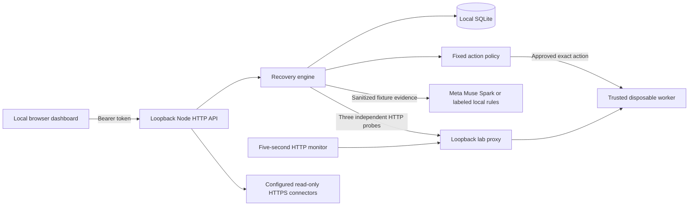

# Architecture

## Recovery lifecycle

`detected → awaiting_approval → executing → recovered`

Diagnosis failures, execution failures and verification failures are distinct visible states. Starting a new application session marks unfinished previous incidents `interrupted`, because the lab is ephemeral; completed receipts survive restart. The lab allows one fault at a time. An engine lock rejects concurrent mutations. Monitoring probes do not execute repairs.

The lab proxy and worker bind to randomly assigned loopback ports. The dashboard binds to loopback port 4310 by default. The stopped-backend scenario terminates only the tracked child process. Recovery starts only a fixed entrypoint with no user arguments. Configuration and release switches affect only that worker's in-memory fixture. There is no shell, SSH, user-supplied executable, file path, or production runner.

Each approval is checked against incident state, immutable target label, expected action, active lab revision, five-minute evidence lifetime, and a fresh failing probe. The engine repeats probes after executing and records all three results. A completed approval cannot be replayed. The authenticated single operator is the approving identity; there is no separate approver role or multi-user attribution yet.

## Evidence and AI boundary

Only synthetic fixture observations are sent to Meta. Inputs pass through recursive redaction, and the developer message declares evidence untrusted. The model returns JSON with a brief hypothesis, confidence, failing evidence routes, and one exact action. Validation rejects unknown actions, missing summaries, invalid confidence and nonexistent or healthy evidence citations. The engine validates again at approval. A valid model response is still a hypothesis, not proof of causality. No chain-of-thought is requested or stored.

Meta API failures remain visible and do not trigger an automatic fallback. Without a key, a deterministic local diagnosis is clearly labeled. Mocked API tests and live API verification are recorded separately.

## Storage and audit

SQLite WAL stores incident JSON and SHA-256 chained audit events. Approval, before/after evidence, verification, action, provider and timestamps appear in receipts. The audit hash commits to receipt content before adding its `auditHash` field. The chain detects edits and broken links, but not administrator replacement or truncation without an external checkpoint. This is local auditability, not nonrepudiation. Incident updates and events are not yet one atomic transaction; production requires crash reconciliation and an outbox.

## External connectors

Operator-owned `config/connectors.json` is the only external target registry. There is no arbitrary URL registration endpoint. HTTPS certificates are verified, all resolved addresses must be accepted public IPv4, and the selected address is pinned to the HTTPS connection while preserving TLS hostname verification. Redirects are not followed, bodies are discarded, and requests time out. IPv6-only endpoints are intentionally unsupported. Bearer credentials may be referenced by environment variable. The Synapse custom-header contract is documented but not implemented in this generic bearer connector; use a reviewed dedicated adapter before connecting Synapse. External probes currently run on demand; the periodic monitor covers the lab only.

## Deployment boundary

This local-first release has no remote hosting configuration. A container template is provided only for reproducibility. It remains loopback-only and is not a public service. Future production work must add multi-user authentication, authorized target ownership, stronger execution isolation, distributed locking, observability, operational limits, durable jobs, secret rotation and retention controls. No production-ready claim is made.
